# Splunk Buttercup Web Log Analysis

I completed this university lab using Splunk Enterprise to investigate the Buttercup online games shop dataset. I searched web access logs, examined HTTP responses and client activity, analysed purchase requests, and created charts.

## Environment and source

- Splunk Enterprise 9.2.0, accessed through the university service.
- Historical Buttercup logs from April 2014; searches used All time.
- Lab guide: [CSN09112 Week 10 Splunk](https://github.com/billbuchanan/csn09112/tree/master/week10_splunk).
- This repository documents my lab work and results. The screenshots are my evidence; the lab instructions and dataset are credited to their respective providers.

## Investigation and findings

### GET requests and client activity

```spl
GET
```

The search returned 24,866 events. The client IP field showed 87.194.216.51 as the most frequent address, with 651 events (2.618%). Frequency alone does not demonstrate malicious activity.

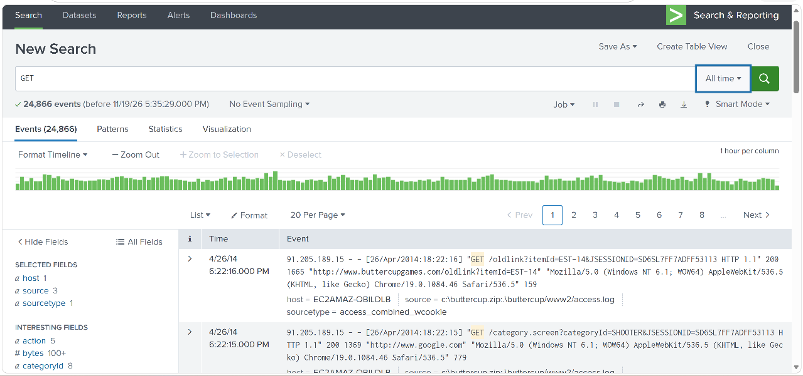
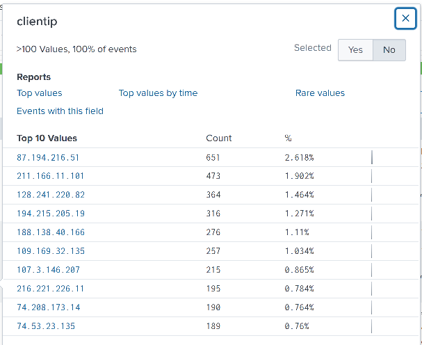

### HTTP responses

I inspected the status field within the GET results. There were 20,890 responses with status 200 (84.01%), 591 with status 408, and 553 with status 404.

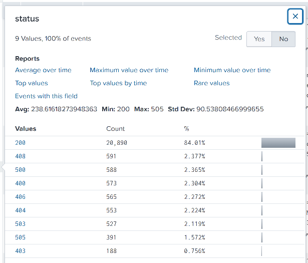

```spl
get status=404
```

This returned 553 events for resources that were not found. I then inspected client IP values and narrowed the search:

```spl
get status=404 clientip="87.194.216.51"
```

This returned 18 events. Missing resources can result from broken links or probing; the response code alone does not establish the cause.

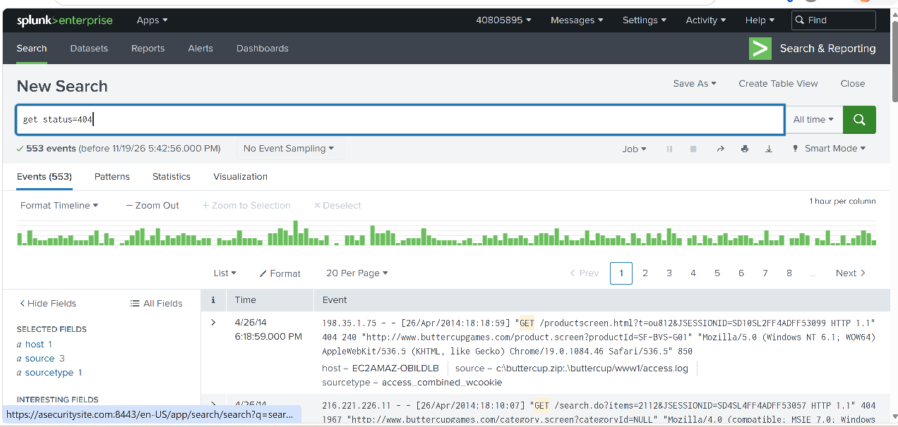
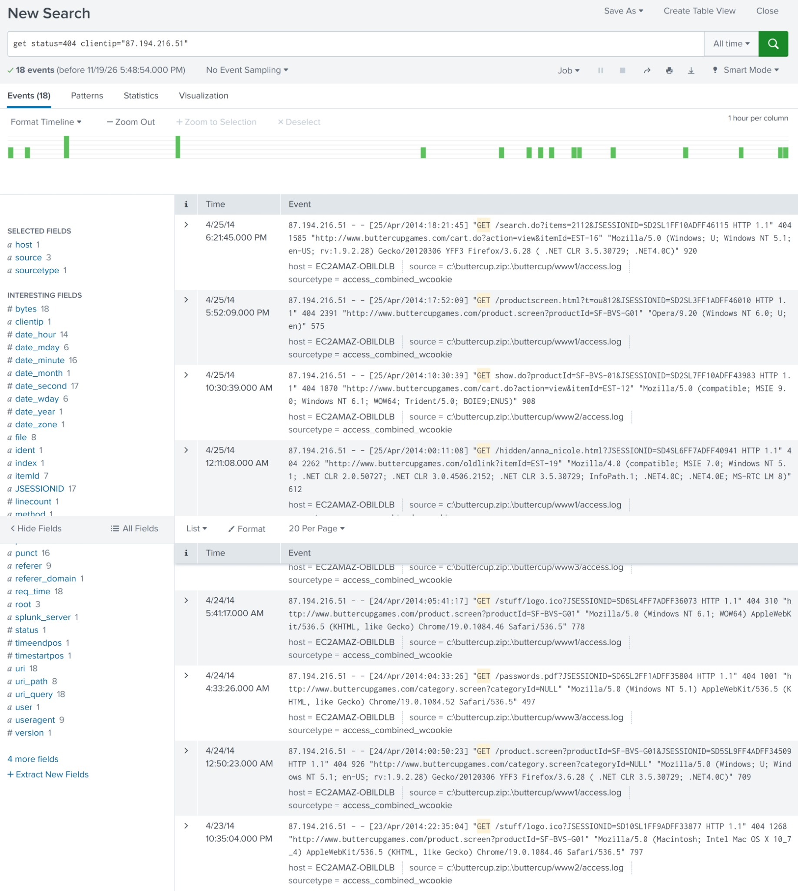

### Requests mentioning passwords.pdf

```spl
passwords.pdf
```

The search returned 68 events with 54 distinct client IP values. The addresses 178.162.239.192 and 87.194.216.51 each appeared in three events. This filename warranted review, but a request does not prove that a file existed or that information was disclosed. The search included both GET and POST events.

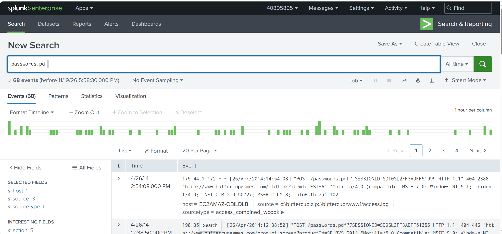
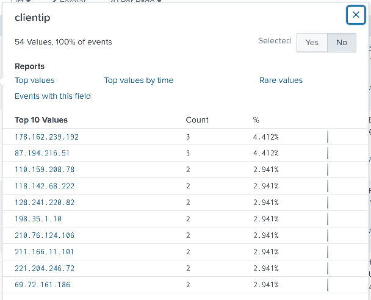

### Purchase requests by category

```spl
sourcetype=access_* status=200 action=purchase | top categoryId
```

The guide treats purchase requests returning HTTP 200 as successful. STRATEGY ranked first with 806 category-bearing events (30.495649%), followed by ARCADE with 493. The seven category counts totalled 2,643; the search interface reported 5,224 matching events. The table percentages apply to the events counted by top, rather than all matching events. HTTP success is not independent confirmation of payment or order fulfilment.

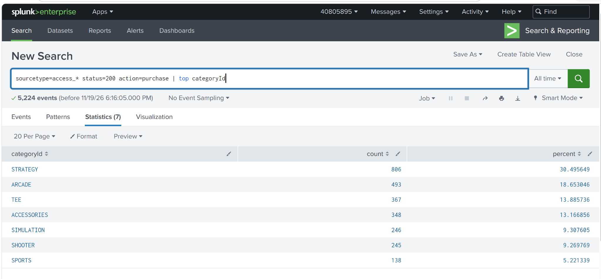

```spl
sourcetype=access_* status!=200 action=purchase | top categoryId
```

The search interface reported 513 matching events. The eight table rows totalled 337: STRATEGY 79, the displayed value NULL 71, ARCADE 44, ACCESSORIES 39, TEE 37, SHOOTER 30, SIMULATION 27 and SPORTS 10. STRATEGY represented 23.442136% of the table total. This percentage is a share of represented events, not a category failure rate.

I displayed these results as a column chart and a pie chart.

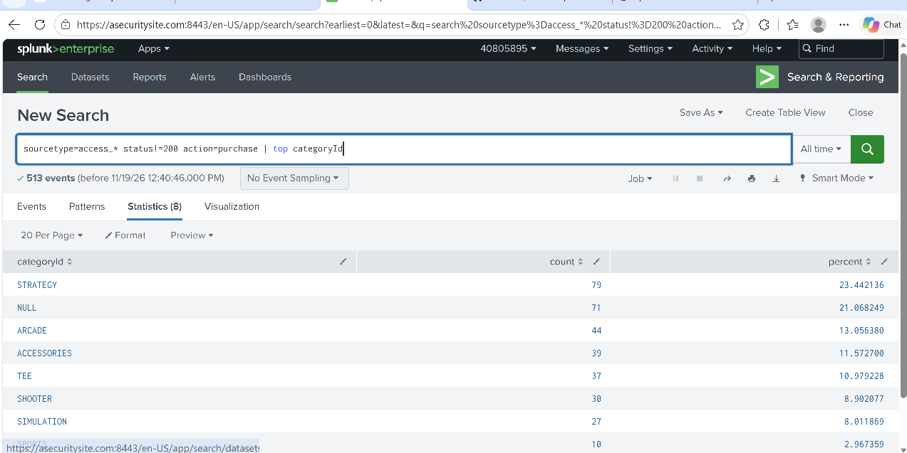
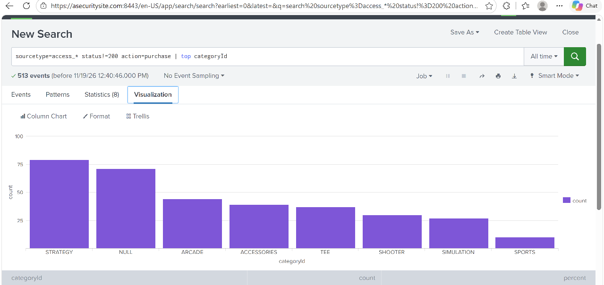
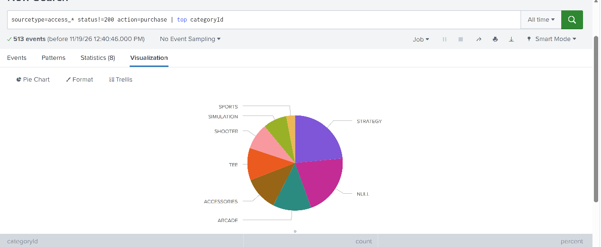

### User agents

```spl
get
| top limit=20 useragent
```

The most frequent user-agent string reported Firefox 3.6.28 on Windows XP, with 5,282 events (21.241856%). These are request counts, not unique visitors. User-agent strings are client-reported information.

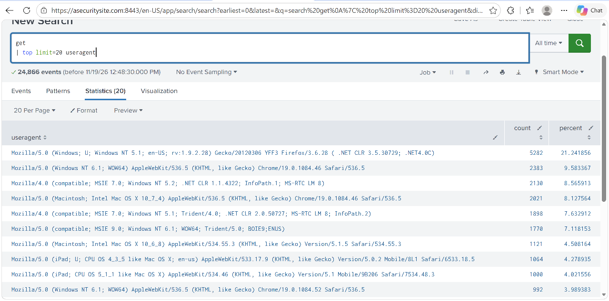

```spl
sourcetype=access_* | chart count(eval(searchmatch("Safari"))) AS Safari, count(eval(searchmatch("Chrome"))) AS Chrome, count(eval(searchmatch("Mozilla"))) AS Mozilla
```

The results were Safari 14,786, Chrome 9,651 and Mozilla 37,346. These keyword counts overlap because one user-agent string can contain multiple names. In the displayed column chart, Splunk used Safari as the horizontal-axis field and Chrome and Mozilla as series. The table beneath the chart retains all three counts.

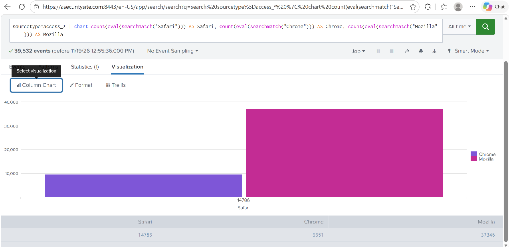

### Purchase requests by product

```spl
post action=purchase | top limit=20 productId
```

The search returned 15 product IDs. WC-SH-G04 ranked first with 275 events, followed by SC-MG-G10 with 273 and DB-SG-G01 with 266. No status filter was used, so these counts represent purchase requests rather than confirmed successful purchases.

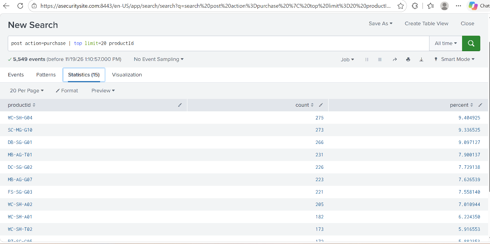
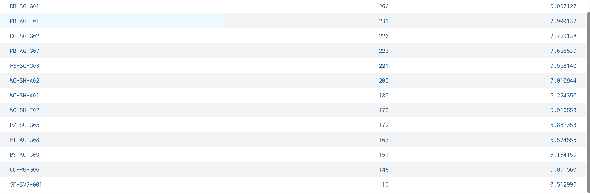

### Mapping products to categories

```spl
get cart.do productId="WC-SH-G04" | top categoryId
```

The category table contained 171 events, all showing SHOOTER. The search interface reported 692 matching events; the category table describes the events represented by that field.

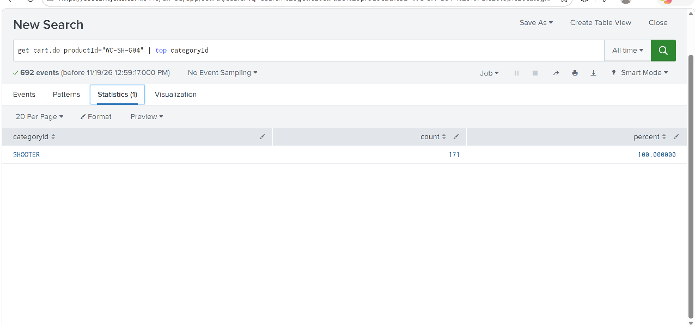

```spl
get cart.do categoryId="STRATEGY" | top productId
```

| Product ID | Events | Percentage |
|---|---:|---:|
| DB-SG-G01 | 171 | 30.105634% |
| DC-SG-G02 | 157 | 27.640845% |
| FS-SG-G03 | 131 | 23.063380% |
| PZ-SG-G05 | 109 | 19.190141% |

These 568 events establish the observed product/category relationship in the searched GET cart activity. They do not count completed sales.

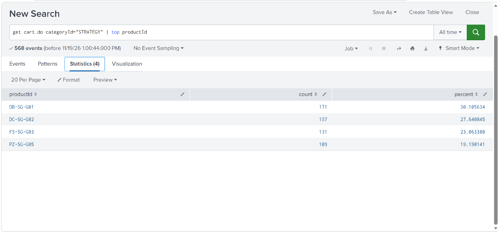
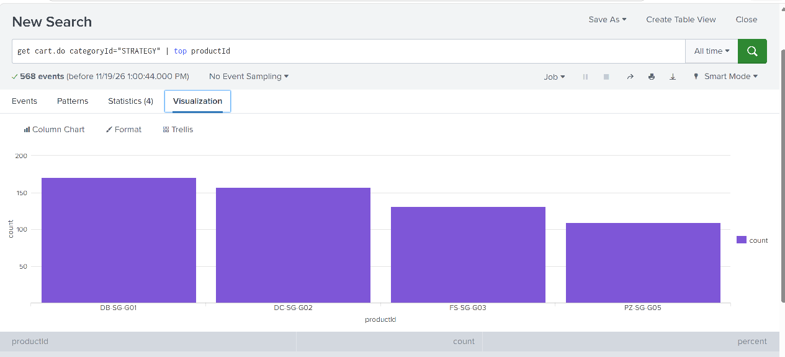

## Skills practised

- Searching historical logs with SPL and field filters.
- Reading HTTP methods, response codes, paths and user agents.
- Inspecting field distributions and ranking values with top.
- Counting conditional matches with chart, eval and searchmatch.
- Building column and pie charts and interpreting their limits.
- Distinguishing observed events from security conclusions and business outcomes.

## Reproducing the searches

Use an authorised Splunk environment containing the Buttercup dataset. Select All time, then run the searches in queries.spl individually. Field availability and counts depend on the dataset and configuration.
